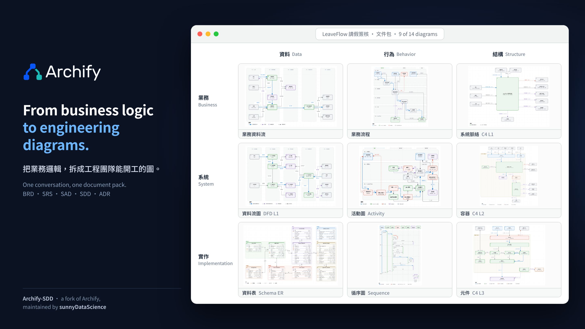

<p align="center">
  <picture>
    <source media="(prefers-color-scheme: dark)" srcset="docs/assets/archify-lockup-dark.svg" />
    
  </picture>
</p>
<h3 align="center">Archify-SDD：從業務邏輯，到工程團隊能開工的那一整套圖。</h3>

<p align="center"></p>
<p align="center"><sub>圖中九張都是 LeaveFlow 參考文件包的實際輸出，不是示意圖。</sub></p>

<p align="center">
  <a href="./README.md"><strong>English</strong></a> &nbsp;·&nbsp;
  <a href="./README_ZH.md"><strong>简体中文</strong></a> &nbsp;·&nbsp;
  <a href="./README_JA.md"><strong>日本語</strong></a> &nbsp;·&nbsp;
  <a href="./README_KO.md"><strong>한국어</strong></a>
</p>

<p align="center">
  <a href="#sdlc"><strong>設計理念</strong></a> &nbsp;·&nbsp;
  <a href="#workflow"><strong>工作流</strong></a> &nbsp;·&nbsp;
  <a href="#try"><strong>馬上試用</strong></a> &nbsp;·&nbsp;
  <a href="#fork"><strong>Fork 與維護</strong></a>
</p>

Archify-SDD 是 [Archify](https://github.com/tt-a1i/archify) 的社群 fork，由 [sunnyDataScience](https://sunnydatascience.com)（GitHub 帳號：[Zenobia000](https://github.com/Zenobia000)）獨立維護。

它只回答一個問題：**怎麼讓 agent 快速把一段業務邏輯拆開，轉成工程團隊真的會拿來開發的圖？**

如果你的工作是把「一句業務需求」變成「分析師、架構師、設計師與開發者各自看得懂、而且彼此對得上的一整套圖」，這個版本就是為這件事準備的。歡迎直接拿去用、挑毛病、送 PR。

## 致敬

Archify-SDD 站在別人的肩膀上，這點要先說清楚。

- **[tt-a1i](https://github.com/tt-a1i) 與 Archify 的貢獻者**：渲染器、互動式 viewer、JSON IR 契約、驗證器、Skill 打包與品質檢查，全部是他們的成果。這個 fork 是在這些基礎上擴充（因此動到了 schema 與 viewer），不是取代。
- **Cocoon AI**：`LICENSE` 同時載明 Cocoon AI 的版權聲明，這個 fork 一併保留。
- 本 repo 完整保留 MIT 授權與上述版權聲明。要的是基礎的人，請直接去 [上游](https://github.com/tt-a1i/archify)；要的是這一層的人，才需要這個版本。

> 上游的贊助商、官方通道、安裝數與 Star 數，描述的是上游專案，不是這個 fork。下方的「[完整 Archify 說明](./README.md)」同樣是上游的內容。

<a id="sdlc"></a>
## 設計理念：把 SDLC 的文件鏈變成圖

sunnyDataScience 的做法，是沿用業界早已有共識的結構，而不是另創一套。

Archify 擅長「把一件事畫成一張可互動的圖」。Archify-SDD 往前多走一步：**這張圖是給誰看的、屬於哪一份文件、跟上一層的圖怎麼接。**

整套設計沿用軟體開發生命週期（SDLC）的文件鏈。每一份核心文件背後，都有一位資深角色在讀、在簽、在拿它做決定，所以每份文件配的圖，就是那個角色的工作語言：

| 階段 | 文件 | 主要讀者 | 回答的問題 | 典型的圖 |
|---|---|---|---|---|
| 需求 | **BRD** 業務需求 | 業務分析師、系統分析師 | 系統為什麼存在 | 業務資料流、業務流程 |
| 分析 | **SRS** 軟體需求規格 | 系統分析師、軟體設計師 | 系統必須做什麼 | DFD Level 1、Activity、狀態機 |
| 架構 | **SAD** 軟體架構 | 軟體架構師 | 系統怎麼構成 | C4 L1 系統脈絡、C4 L2 容器、部署 |
| 設計 | **SDD** 軟體設計 | 軟體設計師、開發者 | 每個部分怎麼實作 | C4 L3 元件、循序圖、Schema ER、類別圖、模組分解 |
| 決策 | **ADR** 架構決策紀錄 | 軟體架構師 | 為什麼選這個 | 一頁式決策紀錄 |

圖再用兩個維度定位，形成 3×3 視角矩陣：

| | 資料 | 行為 | 結構 |
|---|---|---|---|
| **業務** | 業務資料流 | 業務流程 | C4 L1 系統脈絡 |
| **系統** | DFD Level 1 | Activity | C4 L2 容器 |
| **實作** | Schema ER | 循序圖 | C4 L3 元件 |

橫向是抽象層級（業務、系統、實作），縱向是關注主題（資料、行為、結構）。往下一層，就是對上一層的細化：業務流程細化成 Activity，Activity 細化成循序圖；C4 L1 下鑽到 L2，L2 再下鑽到 L3。

這套分類不是新發明，是把分析師、架構師、設計師每天實際在畫的圖，整理成同一張地圖。

<a id="workflow"></a>
## 工作流

這是這個 fork 沉澱下來的做法。使用者只需要描述業務，其餘交給 agent：

1. **描述業務。** 用平常說話的方式講情境，例如「公司要一套請假簽核系統，簽核內建在請假服務裡」。
2. **選視角。** agent 用 `archify guide --role <角色>` 或 `--document <BRD|SRS|SAD|SDD|ADR>` 查出該角色、該文件適合哪些圖，再依你的需求挑。
3. **逐張繪製。** 每張圖是一份 JSON，宣告自己在矩陣中的位置（`meta.viewpoint`），以及跟其他圖共用的穩定元素 ID（`meta.trace`，例如 `C-20` 是請假服務，每張圖都叫同一個 ID）。
4. **組成文件包。** 屬於同一件事的多張圖放進一個資料夾 `.archify/pack-<名稱>-<時間>/`，用 `archify pack render` 產出一個獨立的 `index.html`：視角矩陣、階層樹、追溯表、依角色與文件篩選，點進去就是互動圖。
5. **自動檢查。** 懸空的引用、C4 層級跳級、一個元件掛在多個父層，都會被標出來；`--browser-check` 會在真實瀏覽器裡再驗一次。

**依需求產出，不是一次畫滿九宮格。** 這是刻意的設計：視角目錄是菜單，不是檢查清單。你只要一張 C4 L2，就只畫一張；圖之間的引用是「軟」的，缺的那張不存在時只會降成警告，之後補上也不用回頭改已經畫好的圖。

C4 各層的對應關係也明訂了：L1 一個系統一張；L2 與 L1 一對一；L3 是多對一（每個值得展開的容器各一張）；部署圖是 L2 的另一種檢視，不是新的一層。

<a id="try"></a>
## 馬上試用

### 先看範例

兩套完整的虛構參考文件包，各 14 張圖，涵蓋 BRD、SRS、SAD、SDD、ADR：

| 文件包 | 主題 | 語言 | 入口 |
|---|---|---|---|
| **LeaveFlow** | 企業請假與簽核（動態關卡、代理簽核、退回加簽會簽、逾時升級） | 繁體中文 | `docs/packs/leave-approval/artifacts/index.html` |
| **CareSlot** | 診所預約與提醒 | English | `docs/packs/careslot/artifacts/index.html` |

clone 之後直接用瀏覽器開入口檔即可，不需要網路或建置。

### 本機看完整網站（Architecture Center）

```bash
npm --prefix website ci
npm --prefix website run dev
```

網站有英文、简体、繁體三種語言，可依角色與文件瀏覽圖，並顯示文件類型與階層。

### 安裝這個版本的 Skill

```bash
# 先確認來源只有一個名為 archify 的 Skill
npx -y skills add Zenobia000/archify-SDD --list --full-depth

npx skills add Zenobia000/archify-SDD -g
```

注意：這個 fork 的 Skill 名稱與上游相同，都叫 `archify`。**上游與這個版本請擇一安裝**，不要並存。

安裝之後，直接對 agent 說明你的業務情境，或指名角色與文件，例如「我是系統分析師，幫我畫這個請假系統的 SRS 需要的圖」。其餘的通用能力（10 種原生圖型與一頁式解答、匯出、分享、各 agent 的安裝方式）與上游相同，見 [完整 Archify 說明](./README.md)。

<a id="fork"></a>
## Fork 與維護

- **由 sunnyDataScience 獨立維護。** 這個 fork 自由分岔，路線由維護者決定，不保證與上游同步。
- **選擇性取回上游。** 保留 `upstream` remote，上游有價值的修正（渲染器、viewer、安全性）會評估後合入。
- **問題回報。** 屬於這一層的（視角、追溯、文件包、Architecture Center、繁體中文介面）請開 issue 到本 repo。屬於核心渲染的問題，請先在上游確認是否也會重現。
- **授權。** MIT。`LICENSE` 新增一行 sunnyDataScience（Archify-SDD），並保留 tt-a1i（Archify）與 Cocoon AI 的版權聲明，不得移除。
- **貢獻。** 見 [CONTRIBUTING.md](CONTRIBUTING.md)。

## 這個 fork 新增了什麼

- 視角與追溯：`meta.viewpoint`、`meta.trace`，以及跨圖的穩定元素 ID。
- `reference` 視覺預設：白底、中性色的「架構中心」風格，取代霓虹色調作為文件用圖的外觀。
- 文件包：`archify pack validate|render`，產出獨立的 `index.html`、`pack.manifest.json` 與瀏覽器檢查回條。
- 依角色與文件挑圖：`archify guide --role`、`--document`。
- C4 階層檢查：層級跳級、多父層、無法導覽、下鑽歧義。
- 網站改版為 Architecture Center，並新增繁體中文（`/zh-tw`）。
- LeaveFlow 與 CareSlot 兩套參考文件包。

---

*Archify-SDD 是 [Archify](https://github.com/tt-a1i/archify)（MIT）的衍生作品。感謝 tt-a1i 把底層打得這麼紮實。*
